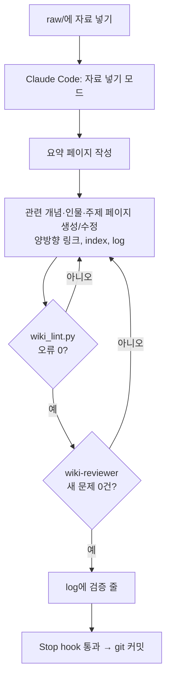

# LLM Wiki — Claude Code로 운영하는 개인 지식 위키

자료를 `raw/`에 넣고 "정리해줘"라고 하면, [Claude Code](https://claude.com/claude-code)가 읽고 요약하고 기존 페이지와 연결해 `wiki/`를 계속 키워 가는 Obsidian 볼트 템플릿입니다.

사람은 자료를 넣고 질문만 합니다. 정리, 교차참조, 목차, 일관성 유지는 에이전트가 맡습니다. 에이전트가 규칙을 어기지 않도록 **검사기·리뷰어·hook**으로 이루어진 검증 루프가 작업 종료를 막습니다.

> 이 저장소에는 시스템만 들어 있고, `raw/`·`wiki/`는 빈 상태(빈 index·log)로 시작합니다. 자료 1건을 넣은 결과는 `examples/`에서 볼 수 있습니다. 실제로 쓰는 위키의 자료는 공개하지 않습니다.

## 특징

| | |
|---|---|
| **규칙은 "언제 읽히나"로 나눔** | 매 세션 필요한 불변 규칙(구조·파일명·정확성·운영 모드 표)만 `CLAUDE.md`에. 절차는 그 일을 할 때 불리는 스킬 5개(`wiki-ingest` · `wiki-query` · `wiki-lint` · `wiki-system` · `wiki-verify`), 페이지 형식 세부는 wiki 파일을 다룰 때 붙는 경로 rules(`.claude/rules/페이지-형식.md`)에. 한 규칙은 한 곳에만 |
| **raw는 불변, wiki는 에이전트 전담** | 원본은 절대 수정하지 않고, 정리본은 에이전트만 씀. 사람이 직접 고친 내용은 존중. PreToolUse hook이 raw 수정을 거부하고, 다른 경로로 바뀐 것은 Stop hook이 잡아 보고 |
| **사실과 해석 구분** | 모든 사실 주장에 출처 페이지 링크, 에이전트의 추론은 `> [!note] 해석`으로 표시, 상충하는 정보는 지우지 않고 표시 |
| **핵심 한 줄** | 모든 페이지 맨 앞에 "요약"이 아니라 "내가 가져갈 것" 한 줄 |
| **기계 검사** | `wiki_lint.py`가 형식, 고아 페이지, 빨간 링크, index 누락, 원문에 없는 인용문, entity 생성 기준, log append-only 등을 검사 |
| **의존 확인** | 아직 커밋하지 않은 변경(git 기준)으로 페이지나 규칙·스킬을 바꾸면, 그것에 기대는데(`sources`로 인용, 요약 페이지를 본문에서 인용, 시스템 이름을 언급) 이번에 손대지 않은 페이지를 경고로 알려 줌 — 고칠지는 에이전트가 열어 보고 판단 |
| **의미 검토** | 글을 쓴 에이전트가 아니라 새 문맥의 읽기 전용 서브에이전트(`wiki-reviewer`)가 원문과 대조해 8개 항목 검토 |
| **hook이 강제** | 이 세션이 새로 만든 오류가 있거나 리뷰어의 "문제 0건" 영수증이 없으면 Stop hook이 작업 종료를 막음 (최대 5회, 넘으면 멈추고 보고) |
| **로컬 git 기록** | 세션 시작 때 사람의 변경을, 검증 통과 시 에이전트의 작업을 따로 커밋해 누가 무엇을 바꿨는지 구분 |

## 동작 흐름



## 구조

```
├── CLAUDE.md                     ← 불변 규칙 + 운영 모드 → 스킬 표 (매 세션 읽힘)
├── raw/                          ← 원본 자료 (불변, 하위 폴더 없음)
├── wiki/                         ← 정리된 지식 (에이전트가 관리)
│   ├── index.md                  ← 전체 목차
│   └── log.md                    ← 작업 이력 (append-only)
├── examples/                     ← 자료 1건을 넣은 결과 예시 (참고용, 검사 대상 아님)
└── .claude/
    ├── skills/                   ← 절차 (그 일을 할 때 불림)
    │   ├── wiki-ingest/          ← 자료 넣기 (references/에 자료 유형별 틀·일괄 처리)
    │   ├── wiki-query/           ← 질문하기
    │   ├── wiki-lint/            ← 건강검진 + 조건부 규칙
    │   ├── wiki-system/          ← 규칙·검사기·hook을 바꿀 때, git 운영
    │   └── wiki-verify/          ← 검증 루프 (작업 끝내기 전 필수)
    ├── rules/페이지-형식.md       ← 페이지 템플릿·링크·index 형식 (wiki/ 파일을 다룰 때 붙음)
    ├── wiki_lint.py              ← 규칙 검사기 + hook 로직
    ├── agents/wiki-reviewer.md   ← 의미 검토 서브에이전트 (검토 항목 8개)
    └── settings.json             ← SessionStart · PreToolUse · SubagentStop · Stop hook
```

## 시작하기

필요한 것: [Claude Code](https://claude.com/claude-code), Python 3, (선택) [Obsidian](https://obsidian.md)

위키는 빈 상태로 들어 있으니 clone하고 바로 시작하면 됩니다.

```bash
git clone <이 저장소> my-wiki
cd my-wiki
git remote remove origin   # (선택) 이 템플릿 저장소와 연결을 끊음 — 위키는 로컬 기록용
```

- **git이 필요합니다.** hook이 세션마다 사용자 변경과 에이전트 작업을 커밋합니다. ZIP으로 받았다면 폴더에서 `git init && git add -A && git commit -m "시작"`을 먼저 실행하세요 (git이 없어도 위키는 동작하지만 기록이 남지 않습니다).
- 템플릿의 커밋 이력 없이 시작하고 싶으면: `rm -rf .git && git init && git add -A && git commit -m "시작"`
- **도메인을 먼저 바꿉니다.** `CLAUDE.md` §3.2의 "현재 도메인" 줄은 예시입니다. 자기 관심 분야로 바꾸세요 (아래 "내 것으로 바꾸기").
- `examples/`는 참고용입니다. 다 봤으면 지워도 됩니다.

그리고 `claude`를 실행합니다.

1. Obsidian에서 이 폴더를 볼트로 엽니다 (선택).
2. 자료를 `raw/YYYY-MM-DD_설명.md`로 넣습니다. Obsidian Web Clipper를 쓰면 편합니다.
3. Claude Code에서 "raw에 자료 넣었어"라고 말합니다.
4. 궁금한 것은 그냥 질문합니다. 위키를 먼저 찾아보고 출처 페이지와 함께 답합니다.
5. 가끔 "건강검진"을 요청해 고아 페이지, 빨간 링크, 오래된 정보, 열린 할 일을 점검합니다.

직접 검사기 돌리기: `python3 .claude/wiki_lint.py` (상태 표시용 JSON: `python3 .claude/wiki_lint.py --status`)

## 내 것으로 바꾸기

- **도메인**: `CLAUDE.md` §3.2의 "현재 도메인" 목록을 자기 관심 분야로 바꿉니다. 검사기가 이 목록을 읽습니다.
- **규칙**: 쓰다가 에이전트가 같은 실수를 반복하면 규칙을 한 줄 더합니다. 자리는 "언제 필요한가"로 정합니다 — 모든 작업에 걸리면 `CLAUDE.md`, 특정 절차에만 걸리면 그 스킬, 페이지 형식이면 `.claude/rules/페이지-형식.md`, 의미 검토 항목이면 `wiki-reviewer.md`. 기계로 확인할 수 있으면 검사기에도 추가합니다. "규칙 바꾸자"라고 하면 `wiki-system` 스킬이 절차를 안내합니다.
- **다른 폴더에서도 위키 조회**: `~/.claude/CLAUDE.md`에 "정보를 찾을 때는 먼저 이 위키를 조회한다"는 전역 규칙을 두면, 어느 프로젝트에서 작업하든 위키를 참고합니다.

## 영감

- Andrej Karpathy의 "LLM Wiki" 아이디어 — RAG로 매번 원문을 찾는 대신, LLM이 계속 관리하는 누적형 위키
- Geoffrey Huntley의 "Ralph" 루프 — 에이전트가 완료 기준을 통과할 때까지 되돌려 보내는 루프. 이 템플릿에서는 검증 루프 이름으로 씀
