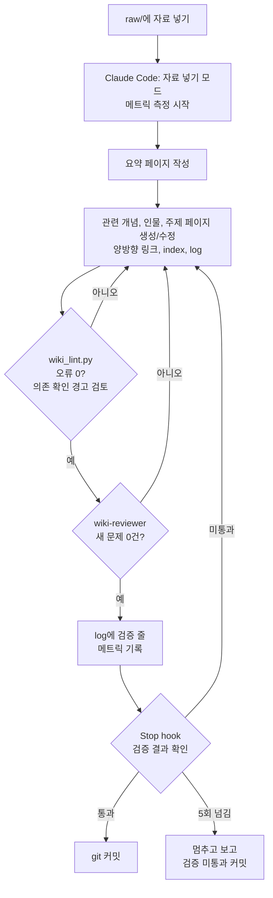

# LLM Wiki: Claude Code로 운영하는 개인 지식 위키

자료를 `raw/`에 넣고 "정리해줘"라고 하면 [Claude Code](https://claude.com/claude-code)가 읽고, 요약하고, 기존 페이지와 연결해 `wiki/`를 키워 가는 Obsidian 볼트 템플릿입니다.

RAG처럼 질문할 때마다 원문을 다시 찾는 대신, 자료를 넣을 때마다 정리된 위키가 쌓이고 검증됩니다. 사람은 자료를 넣고 질문만 합니다. 정리, 교차참조, 목차 관리, 일관성 유지는 에이전트가 맡습니다. 에이전트가 규칙을 어기면 **검사기, 리뷰어, hook**으로 이루어진 검증 루프를 통과할 때까지 작업을 완료할 수 없습니다.

> 이 저장소에는 시스템만 들어 있습니다. `raw/`와 `wiki/`는 비어 있고(`wiki/`에는 빈 index와 log만 있음), 예시 자료도 없습니다. clone한 뒤 지울 것 없이 바로 자기 자료를 넣으면 됩니다.

## 특징

| | |
|---|---|
| **raw는 불변, wiki는 에이전트가 관리** | 원본은 절대 수정하지 않고, 정리본은 기본적으로 에이전트가 관리합니다. 사람이 `wiki/`를 직접 수정한 경우 기존 변경을 보존합니다. PreToolUse hook이 raw 수정을 거부하고, 다른 경로를 통해 raw가 변경된 경우에도 Stop hook이 감지해 보고합니다 |
| **사실과 해석 구분** | 모든 사실 주장에 출처 페이지를 링크합니다. 에이전트의 추론은 `> [!note] 해석`으로 표시하고, 서로 다른 정보는 지우지 않고 상충으로 표시합니다 |
| **핵심 한 줄** | 모든 페이지 맨 앞에 "요약"이 아니라 "내가 가져갈 것"을 한 줄로 씁니다 |
| **기계 검사** | `wiki_lint.py`가 형식, 고아 페이지, 빨간 링크, `[[페이지#섹션]]` 링크의 섹션 존재 여부, index 누락, 원문에 없는 인용문, entity 생성 기준, log append-only 위반 등을 검사합니다 |
| **의미 검토** | 작성 작업에 참여하지 않은 읽기 전용 서브에이전트(`wiki-reviewer`)가 별도의 문맥에서 원문과 대조해 8개 항목을 검토합니다 |
| **hook으로 검증을 강제** | 이 세션이 새로 만든 오류가 있거나 리뷰어의 "문제 0건" 검증 결과가 없으면 Stop hook이 작업 종료를 막습니다. 5회까지 막고, 넘으면 멈추고 보고합니다. 검사기나 `CLAUDE.md`를 바꾼 세션은 A층 회귀(`.claude/regress/run.py A`)를 통과해야 끝납니다 |
| **의존 확인** | 페이지, 규칙, 스킬이 변경되면 그 변경의 영향을 받을 수 있는 다른 페이지를 찾아 경고합니다. 의존 관계는 `sources` 인용, 본문의 요약 페이지 인용, 시스템 구성요소 이름 언급을 바탕으로 추적합니다. 실제 수정이 필요한지는 에이전트가 페이지를 확인한 뒤 판단합니다 |
| **회귀 스위트** | 규칙, 검사기, 스킬, 리뷰어를 바꾼 뒤 예전에 고친 실수가 다시 나오는지 확인합니다. A층은 테스트용 위키에 검사기를 실행해 기대 출력과 비교합니다. B층은 미니 볼트에서 리뷰어를 실행해 과거의 실제 실수를 다시 탐지하는지 확인합니다. 템플릿에는 러너와 예시 케이스 3건만 있습니다. 케이스는 실수를 고칠 때마다 직접 추가합니다. 세부는 [회귀 스위트 사용법](.claude/regress/README.md)에 있습니다 |
| **규칙을 필요한 시점에 따라 분리** | 매 세션 필요한 불변 규칙(구조, 파일명, 정확성, 운영 모드 표)만 `CLAUDE.md`에 둡니다. 절차는 해당 작업을 수행할 때 사용하는 스킬 5개(`wiki-ingest`, `wiki-query`, `wiki-lint`, `wiki-system`, `wiki-verify`)에, 페이지 형식 세부는 wiki 파일을 다룰 때만 적용되는 경로 rules(`.claude/rules/페이지-형식.md`)에 둡니다. 한 규칙은 한 곳에만 씁니다 |
| **로컬 git 기록** | 세션을 시작할 때 사람의 변경을, 검증을 통과하면 에이전트의 작업을 따로 커밋해 누가 무엇을 바꿨는지 구분합니다 |
| **운영 메트릭** | 자료를 넣을 때마다 걸린 시간, 토큰, 호출 수를 `.claude/metrics/ingest_history.jsonl`에 한 줄씩 남기고 함께 커밋합니다. 규칙이나 모델을 바꾼 전후로 자료 처리 비용을 비교할 때 씁니다. 세부는 [운영 메트릭 사용법](.claude/metrics/README.md)에 있습니다 |

## 동작 흐름



## 구조

```
├── CLAUDE.md                     ← 불변 규칙 + 운영 모드별 스킬 표 (모든 세션에 적용)
├── raw/                          ← 원본 자료 (불변, 하위 폴더 없음)
├── wiki/                         ← 정리된 지식 (에이전트가 관리)
│   ├── index.md                  ← 전체 목차
│   └── log.md                    ← 작업 이력 (append-only)
└── .claude/
    ├── skills/                   ← 절차 (필요한 작업에서만 사용)
    │   ├── wiki-ingest/          ← 자료 넣기 (references/에 자료 유형별 틀, 일괄 처리)
    │   ├── wiki-query/           ← 질문하기
    │   ├── wiki-lint/            ← 건강검진 + 조건부 규칙
    │   ├── wiki-system/          ← 규칙, 검사기, hook을 바꿀 때 + git 운영
    │   └── wiki-verify/          ← 검증 루프 (작업 끝내기 전 필수)
    ├── rules/페이지-형식.md       ← 페이지 템플릿, 링크, index 형식 (wiki/ 작업 시 적용)
    ├── wiki_lint.py              ← 규칙 검사기 + hook 로직
    ├── agents/wiki-reviewer.md   ← 의미 검토 서브에이전트 (검토 항목 8개)
    ├── regress/                  ← 회귀 스위트 (러너, 예시 케이스 3건, 사용법 README)
    ├── metrics/                  ← 자료 처리 비용 측정 (ingest_history.jsonl에 기록)
    └── settings.json             ← SessionStart, PreToolUse, SubagentStop, Stop hook
```

## 시작하기

필요한 것: [Claude Code](https://claude.com/claude-code), Python 3, (선택) [Obsidian](https://obsidian.md)

```bash
git clone https://github.com/tgYun783/llm-wiki-template.git my-wiki
cd my-wiki
git remote remove origin   # (선택) 템플릿 저장소와 연결을 끊음. 위키는 로컬 기록용
```

- **git이 필요합니다.** hook이 세션마다 사용자 변경과 에이전트 작업을 커밋합니다. ZIP으로 받았다면 폴더에서 `git init && git add -A && git commit -m "시작"`을 먼저 실행하세요. git이 없어도 위키는 동작하지만 기록이 남지 않습니다.
- 템플릿의 커밋 이력 없이 시작하려면 `rm -rf .git && git init && git add -A && git commit -m "시작"`을 실행합니다.
- **도메인은 비어 있습니다.** `CLAUDE.md` §3.2의 "현재 도메인" 줄에 아직 도메인이 없습니다. 첫 자료를 넣으면 에이전트가 도메인을 제안하고, 확인을 받아 추가합니다. 미리 정해 두려면 직접 적어도 됩니다(아래 "내 것으로 바꾸기").

사용 순서:

1. 폴더에서 `claude`를 실행합니다.
2. (선택) Obsidian에서 이 폴더를 볼트로 엽니다.
3. 자료를 `raw/YYYY-MM-DD_설명.md`로 넣습니다. Obsidian Web Clipper를 쓰면 편합니다.
4. Claude Code에 "raw에 자료 넣었어"라고 말합니다.
5. 궁금한 것은 그냥 질문합니다. 에이전트가 위키를 먼저 찾아보고 출처 페이지와 함께 답합니다.
6. 필요할 때 "건강검진"을 요청합니다. 고아 페이지, 빨간 링크, 오래된 정보, 열린 할 일을 점검합니다.

검사기를 직접 돌리려면 `python3 .claude/wiki_lint.py`를 실행합니다. 상태 표시용 JSON은 `python3 .claude/wiki_lint.py --status`로 봅니다.

## 내 것으로 바꾸기

- **도메인**: `CLAUDE.md` §3.2의 "현재 도메인" 줄에 관심 분야를 `` `도메인/<이름>` `` 형식으로, 쉼표로 나눠 적습니다(예: `` - 현재 도메인: `도메인/업무`, `도메인/독서` ``). 검사기가 이 줄을 읽고, 목록에 없는 도메인 태그를 오류로 잡습니다.
- **규칙**: 에이전트가 같은 실수를 반복하면 규칙을 한 줄 더합니다. 규칙의 위치는 적용되는 시점에 따라 정합니다. 모든 작업에 걸리면 `CLAUDE.md`, 특정 절차에만 걸리면 그 스킬, 페이지 형식이면 `.claude/rules/페이지-형식.md`, 의미 검토 항목이면 `wiki-reviewer.md`에 둡니다. 기계로 확인할 수 있으면 검사기에도 넣습니다. "규칙 바꾸자"라고 하면 `wiki-system` 스킬이 절차를 안내합니다.
- **다른 폴더에서도 위키 조회**: `~/.claude/CLAUDE.md`에 "정보를 찾을 때는 먼저 이 위키를 조회한다"는 전역 규칙을 두면, 어느 프로젝트에서 작업하든 에이전트가 위키를 참고합니다.

## 도움 받기

질문이나 버그 보고는 이 저장소의 [GitHub Issues](https://github.com/tgYun783/llm-wiki-template/issues)에 남겨 주세요.

## 관리와 기여

GitHub 계정 `tgYun783`이 혼자 관리하는 개인 프로젝트입니다.

기여하려면 먼저 Issue로 제안한 뒤 Pull Request를 보내 주세요. 규칙이나 검사기를 바꾸는 기여는 회귀 스위트 A층(`python3 .claude/regress/run.py A`)을 통과해야 합니다.

## 라이선스

[MIT License](LICENSE)로 배포합니다.

## 영감

- Andrej Karpathy의 "LLM Wiki" 아이디어: RAG로 매번 원문을 찾는 대신, LLM이 계속 관리하는 누적형 위키
- Geoffrey Huntley의 "Ralph" 루프: 에이전트가 완료 기준을 통과할 때까지 되돌려 보내는 루프. 이 템플릿에서는 검증 루프의 이름으로 씁니다
- Meta Engineering 블로그의 ["An Organizational Second Brain"](https://engineering.fb.com/2026/09/02/ml-applications/organizational-second-brain-ai-learns-from-experts/) (2026-09): 전문가 지식 에이전트를 지식 시스템, 추론 레시피, 평가, 자기 개선 루프의 네 층으로 나눈 사례. 이 글을 이 위키와 층별로 대조해 빈 곳 세 군데를 채웠습니다. 파일 사이의 의존 그래프는 검사기의 의존 확인으로, 실수의 근본 원인 판정은 `wiki-verify` 스킬로, 고칠 때마다 커지는 회귀 테스트는 회귀 스위트로 들어왔습니다
